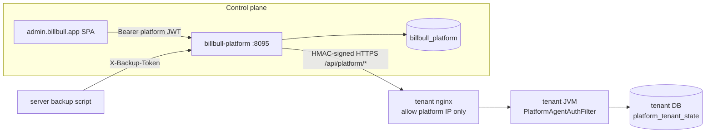

# BillBull Platform Control Center — architecture

`admin.billbull.app` is where BillBull staff manage clients: registry, plans and modules, suspension,
health, backups, support access and an audit trail. It was built on top of the existing
database-per-client model rather than replacing it.

## Pieces

| Piece | Where | What it is |
|---|---|---|
| Platform service | `billbull-platform/` (Spring Boot 3.5.9, Java 17) | The control plane API, port 8095. Its own PostgreSQL database (`billbull_platform`, Flyway `db/platform/V1`). Never connects to a tenant database. |
| Admin app | `billbull-frontend/apps/admin/` (`npm run dev:admin` / `build:admin`) | React SPA for admin.billbull.app. Talks only to the platform service. Must not import `@billbull/shared` (enforced by `scripts/workspaceBoundaries.mjs`). |
| Platform agent | `billbull-backend/.../platform/` | A small HMAC-signed API in every tenant backend (`/api/platform/**`), plus the enforcement filters. Off unless `BILLBULL_PLATFORM_AGENT_ENABLED=true`. |
| Tenant UI pieces | Retail `src/auth/SupportLogin.jsx`, `src/pages/Settings/BillBullAccount.jsx` | `/support-login` (support sign-in link) and Settings → BillBull Account (plan, modules, support sessions with "End now"). |

## How a decision reaches a client

1. An operator changes something (status, plan, module override, limit). `TenantService` saves it,
   bumps the tenant's `configVersion` and writes an audit event.
2. The platform pushes `PUT /api/platform/state` straight away; `StateSyncService` retries every
   minute until the tenant acknowledges that version (`appliedConfigVersion`).
3. The tenant stores it in the single-row `platform_tenant_state` (V148) and caches it for 15 s.
4. Enforcement on the tenant, before any controller:
   - `PlatformPolicyFilter`: SUSPENDED → 423 on every `/api/**` (sign-in included); READ_ONLY → 423
     on writes (sign-in and branch switch still allowed); module off → 403 `MODULE_NOT_ENTITLED` on that
     module's API paths (`PlatformModules`).
   - `ModulePermissionService`: a module the plan excludes fails every permission check, ADMIN included.
   - `/api/role-permissions/me` reports excluded modules as all-false, so the sidebar hides them.
   - Limits: `UserService` (active users), `BranchService` (branches), `PosTerminalLimitPolicy`
     (terminals per branch) return 409 "Your plan allows N …".
5. The health poll (`HealthService`, every 5 minutes by default) reads `configVersion` back.
   If the tenant reports another value (restored database, hand edit), the platform re-pushes.

An unmanaged tenant (no state row, or agent disabled) behaves exactly as before. If the state row
can't be read, the tenant fails *open* and logs it — a control-plane fault must never lock a shop
out of its till.

Disabling a module only blocks HTTP calls into it. Internal postings (a sale's GL entries while
finance is off) still happen, so turning it back on loses nothing.

## Modules and plans

Optional modules: `pos`, `purchases`, `finance`, `hr`, `customer` (the same list in
`PlatformModules` and `Modules` — both test suites pin it). Sales, inventory, dashboard and user
management are core. Seeded plans: STARTER (pos; 5 users, 1 branch, 2 terminals), GROWTH
(pos, purchases, finance; 20/3/5), ENTERPRISE (all, unlimited). Effective entitlement = tenant
override if set, else the plan (`Entitlements.resolve`).

## Agent API (tenant side)

| Call | Purpose |
|---|---|
| `GET /api/platform/health` | Build (version, jar time, jar SHA-256), JVM, DB latency and size, Flyway version/pending/failed, usage counts, current state. No business records. |
| `GET/PUT /api/platform/state` | Read / replace status, plan, modules, limits (idempotent, versioned). |
| `GET/POST /api/platform/support-sessions`, `POST …/{id}/revoke` | Time-boxed support sign-in. |
| `/api/platform/db/**` | Database console: overview, tables, insights, sessions, guarded SQL, EXPLAIN, maintenance jobs, `pg_dump` backups. Data access needs the client's own switches — see `DATABASE_CONSOLE.md`. |
| `PUT /api/platform/announcements`, `GET …/stats` | Replace the client's live announcements; the reply carries per-announcement seen counts. |
| `GET /api/platform/errors?afterGroupSeq=&afterEventId=&limit=` | Error log page: error groups changed and occurrences recorded after the cursors, plus `maxGroupSeq`/`maxEventId` so a restored database is noticed. Redacted text, no request bodies. |
| `GET /api/platform/presence` | Live Clients: devices seen in the last 24 h (user, roles, branch, app, user agent, IP, since, last seen, online), open till sessions, terminals online/total, invoices created today. Names and counts only. |

Signature (`PlatformSignature` / `AgentSignature`, pinned to the same test vectors):
`hex(HMAC-SHA256(secret, METHOD\nPATH\nTIMESTAMP\nNONCE\nhex(SHA-256(body))))` in
`X-Platform-Signature`, with `X-Platform-Timestamp` (±300 s) and a single-use `X-Platform-Nonce`.
Each tenant has its own 64-character secret, generated by the platform and shown once.

## Support access

Consent stays with the client: the server must set `BILLBULL_PLATFORM_SUPPORT_ACCESS_ENABLED=true`
and the client's admin must keep an active `platform.support` user (its roles decide what support
can do; freezing it ends all support access). The platform asks the agent for a token (5–60 min,
`sst` session claim), records the session on both sides and opens
`https://<client>/support-login#token=…` — the fragment never reaches a server log. `JwtFilter`
checks the session on every request, so revoking from either side cuts the token off immediately.

## Announcements

Operators publish announcements (type, title, message, audience: whole team or owners & admins,
every client or chosen ones, optional show window) on the **Announcements** page. Platform tables
(`db/platform` V2): `announcements`, `announcement_targets`, `announcement_tenant_stats`,
`announcement_sync`. `AnnouncementSyncService` sends each client its **complete** live set with
`PUT /api/platform/announcements`. It sends right after a change, re-sends whenever the set's hash
differs or the last attempt failed, and otherwise refreshes every
`platform.announcements.refresh-ms` (5 min) to collect seen counts. Archiving, deleting,
un-targeting or passing the end time all drop the announcement from the set, so the client
deactivates it. Clients that were down catch up on the next cycle.

On the client (tenant V153: `platform_announcements`, `platform_announcement_views`), the Retail
app's `PlatformAnnouncements` popup asks `GET /api/platform-access/announcements/pending` after
sign-in and every 5 minutes, then calls `POST …/{id}/seen` on "Got it". Each announcement pops up
once per user, on any device. Editing one sends the new text but does not re-show it to people
who already dismissed it. The `platform.support` user never sees them or counts toward them. A
READ_ONLY client can still dismiss them.

The same component (`@billbull/shared/components/PlatformAnnouncements`) runs on the standalone
POS till with `variant="till"`. There it checks once, at sign-in, and never re-checks, so it can't
appear mid-sale. Its button never takes focus and ignores keyboard activation, so a barcode
scanner's trailing Enter can't dismiss it unread; only a click or tap closes it.

## Live clients

The **Live clients** page shows which clients have someone signed in now and on which devices.
On the client, `JwtFilter` hands every authenticated request to `presence.UserPresenceService`,
which upserts one row per device into `user_presence` (tenant V156) at most once a minute. A
device is (user, browser install): Retail and the POS send `X-Client-App` (`retail`/`pos`) and a
random per-browser `X-Client-Device` id from `localStorage`. Calls without that id are keyed on
user agent + IP. An Electron user agent marks the POS desktop app. A device is online when it was
active in the last 3 minutes, and a gap of over 30 minutes starts a new "since". Rows are pruned
after 30 days. A recording error never fails the request; recording backs off for 10 minutes instead.

The platform's `LiveClientsService` (`GET /api/live-clients`, VIEWER) asks every non-archived
client's agent in parallel and caches the fleet view for 10 s (`platform.live.cache-ms`).
`?fresh=true` skips the cache unless it is under 3 s old. The page polls every 30 s while
visible. A client whose health is UP but whose agent returns 404 for `/presence` runs an older
build and shows **Needs update**. The health report also carries `onlineDevices`/`onlineUsers`,
stored in `health_snapshots` (platform V4), and they draw the 24-hour activity line.

## Error logs

**On each client** (`com.billbull.backend.errorlog`, tenant V155 `error_log_groups` /
`error_log_events`), errors are captured at four points:

| Source | Capture point | What |
|---|---|---|
| `SERVER` | `ErrorCaptureResolver` parks every controller exception; `ErrorCaptureFilter` records it with the final status (and anything that escapes the filter chain, as 500). | Unexpected faults and deliberate refusals. Expected answers (403, 404, approval prompts, rate limits, client disconnects) are skipped: `ErrorCaptureSupport.shouldRecord`. |
| `CLIENT` | `ClientLogController`, level `error`. | Browser crashes from signed-in users only, capped at 120 per minute per client (the endpoint is public). |
| `JOB` | `ErrorLogAppender` on the root logger. | ERROR lines off a request thread: scheduled jobs, async work, seeders. |
| `LOG` | The same appender, held per request. | ERROR lines during a request that itself recorded nothing. A request that recorded its own exception drops them, because they describe the same fault. |

Occurrences are grouped by a fingerprint: source, exception chain, the first BillBull stack frame
that isn't a servlet filter, endpoint template (`/api/x/{id}`) and the message with its values
removed. Each occurrence bumps the group's count; an event row is kept for at most 20 per group
per minute, so a storm can't fill the disk. Writing happens on one background thread with a
bounded queue and can't fail or slow a request. Retention: events 30 days, groups 180 days
(`billbull.error-log.*`). Switch off with `billbull.error-log.enabled=false`.

**On the platform** (`com.billbull.platform.errors`, `db/platform` V3 `error_groups`,
`error_events`, `error_sync_state`), `ErrorSyncService` pulls each client every 5 minutes
(`platform.errors.poll-interval-ms`; up to 10 pages of 200) and on **Pull now**. `ErrorExplainer`
classifies each group against an ordered catalogue of rules. Each rule gives a plain-language
title, what happened, the business impact for the client's ERP module, the usual causes, the
recommended actions and who acts first. Specific rules come first (posting-engine codes, SQL
states, schema mismatch, pool exhaustion, document-number collisions, network printers, PDF
rendering), then broader ones (any NullPointerException, browser crashes, business-rule
refusals), then `UNCLASSIFIED`. The ERP module comes from the API path, the screen URL or the
logger's package. Classification is stored for filtering but recomputed on every pull and at
startup, so improving a rule re-labels history. A defect on a trading-critical path (checkout,
day close, sign-in) is always CRITICAL. A group marked RESOLVED that happens again reopens as
OPEN with a **Regressed** flag. The full catalogue is on the **Error guide** page
(`GET /api/errors/catalog`). Open critical or high-severity faults from the last 24 hours appear
under **Needs attention** on the dashboard.

## Security fixes shipped with this

- **`tid` claim (audit R1).** Every tenant JWT names its client; `JwtUtil.isTokenValid` refuses a
  token for another client even when two clients share a signing key. Old tokens without `tid` are
  accepted until `BILLBULL_JWT_REQUIRE_TENANT_CLAIM=true`.
- **Unguarded GL endpoints (R5).** Opening-balance posting and account archive/unarchive now need
  `finance.ledger` permissions.
- **CORS origins from the environment.** `BILLBULL_CORS_EXTRA_ORIGINS` adds a new client's origin
  without a code change.
- `SecurityConfig`'s role-hierarchy comment corrected (ADMIN includes BRANCH_ADMIN, not the reverse).

Still open, and needing server access: rotate the committed secrets and move them to env files, one
DB role per client, separate working directories (see `SECURITY.md`).
