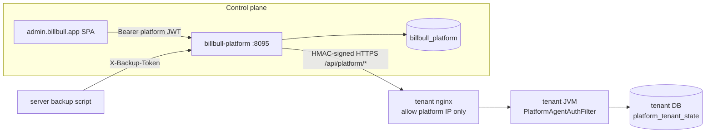

# BillBull Platform Control Center — architecture

`admin.billbull.app` is where BillBull staff manage clients: registry, plans and modules, suspension,
health, backups, support access and an audit trail. It was built on top of the existing
database-per-client model rather than replacing it.

## Pieces

| Piece | Where | What it is |
|---|---|---|
| Platform service | `billbull-platform/` (Spring Boot 3.5.9, Java 17) | The control plane API, port 8095. Its own PostgreSQL database (`billbull_platform`, Flyway `db/platform/V1`). Never connects to a tenant database. |
| Admin app | `billbull-frontend/apps/admin/` (`npm run dev:admin` / `build:admin`) | React SPA for admin.billbull.app. Talks only to the platform service. Must not import `@billbull/shared` (enforced by `scripts/workspaceBoundaries.mjs`). |
| Platform agent | `billbull-backend/.../platform/` | A small HMAC-signed API in every tenant backend (`/api/platform/**`), plus the enforcement filters. Off unless `BILLBULL_PLATFORM_AGENT_ENABLED=true`. |
| Tenant UI pieces | Retail `src/auth/SupportLogin.jsx`, `src/pages/Settings/BillBullAccount.jsx` | `/support-login` (support sign-in link) and Settings → BillBull Account (plan, modules, support sessions with "End now"). |

## How a decision reaches a client

1. An operator changes something (status, plan, module override, limit). `TenantService` saves it,
   bumps the tenant's `configVersion` and writes an audit event.
2. The platform pushes `PUT /api/platform/state` straight away; `StateSyncService` retries every
   minute until the tenant acknowledges that version (`appliedConfigVersion`).
3. The tenant stores it in the single-row `platform_tenant_state` (V148) and caches it for 15 s.
4. Enforcement on the tenant, before any controller:
   - `PlatformPolicyFilter`: SUSPENDED → 423 on every `/api/**` (sign-in included); READ_ONLY → 423
     on writes (sign-in and branch switch still allowed); module off → 403 `MODULE_NOT_ENTITLED` on that
     module's API paths (`PlatformModules`).
   - `ModulePermissionService`: a module the plan excludes fails every permission check, ADMIN included.
   - `/api/role-permissions/me` reports excluded modules as all-false, so the sidebar hides them.
   - Limits: `UserService` (active users), `BranchService` (branches), `PosTerminalLimitPolicy`
     (terminals per branch) return 409 "Your plan allows N …".
5. The health poll (`HealthService`, every 5 minutes by default) reads `configVersion` back.
   If the tenant reports another value (restored database, hand edit), the platform re-pushes.

An unmanaged tenant (no state row, or agent disabled) behaves exactly as before. If the state row
can't be read, the tenant fails *open* and logs it — a control-plane fault must never lock a shop
out of its till.

Disabling a module only blocks HTTP calls into it. Internal postings (a sale's GL entries while
finance is off) still happen, so turning it back on loses nothing.

## Modules and plans

Optional modules: `pos`, `purchases`, `finance`, `hr`, `customer` (the same list in
`PlatformModules` and `Modules` — both test suites pin it). Sales, inventory, dashboard and user
management are core. Seeded plans: STARTER (pos; 5 users, 1 branch, 2 terminals), GROWTH
(pos, purchases, finance; 20/3/5), ENTERPRISE (all, unlimited). Effective entitlement = tenant
override if set, else the plan (`Entitlements.resolve`).

## Agent API (tenant side)

| Call | Purpose |
|---|---|
| `GET /api/platform/health` | Build (version, jar time, jar SHA-256), JVM, DB latency and size, Flyway version/pending/failed, usage counts, current state. No business records. |
| `GET/PUT /api/platform/state` | Read / replace status, plan, modules, limits (idempotent, versioned). |
| `GET/POST /api/platform/support-sessions`, `POST …/{id}/revoke` | Time-boxed support sign-in. |

Signature (`PlatformSignature` / `AgentSignature`, pinned to the same test vectors):
`hex(HMAC-SHA256(secret, METHOD\nPATH\nTIMESTAMP\nNONCE\nhex(SHA-256(body))))` in
`X-Platform-Signature`, with `X-Platform-Timestamp` (±300 s) and a single-use `X-Platform-Nonce`.
Each tenant has its own 64-character secret, generated by the platform and shown once.

## Support access

Consent stays with the client: the server must set `BILLBULL_PLATFORM_SUPPORT_ACCESS_ENABLED=true`
and the client's admin must keep an active `platform.support` user (its roles decide what support
can do; freezing it ends all support access). The platform asks the agent for a token (5–60 min,
`sst` session claim), records the session on both sides and opens
`https://<client>/support-login#token=…` — the fragment never reaches a server log. `JwtFilter`
checks the session on every request, so revoking from either side cuts the token off immediately.

## Security fixes shipped with this

- **`tid` claim (audit R1).** Every tenant JWT names its client; `JwtUtil.isTokenValid` refuses a
  token for another client even when two clients share a signing key. Old tokens without `tid` are
  accepted until `BILLBULL_JWT_REQUIRE_TENANT_CLAIM=true`.
- **Unguarded GL endpoints (R5).** Opening-balance posting and account archive/unarchive now need
  `finance.ledger` permissions.
- **CORS origins from the environment.** `BILLBULL_CORS_EXTRA_ORIGINS` adds a new client's origin
  without a code change.
- `SecurityConfig`'s role-hierarchy comment corrected (ADMIN includes BRANCH_ADMIN, not the reverse).

Still open, and needing server access: rotate the committed secrets and move them to env files, one
DB role per client, separate working directories (see `SECURITY.md`).
